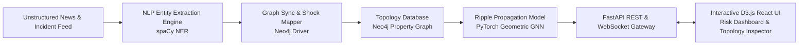

# AtmoGraph: Supply Chain Ripple Effect Predictor

[](https://opensource.org/licenses/MIT)
[](https://fastapi.tiangolo.com)
[](https://pytorch-geometric.readthedocs.io)
[](https://neo4j.com)
[](https://react.dev)
[](https://www.typescriptlang.org)

AtmoGraph is an enterprise-grade Graph Neural Network (GNN) and Natural Language Processing (NLP) powered supply chain risk intelligence platform. It forecasts multi-tier ripple effects, bottlenecks, and delivery delays across global supplier networks when localized disruptions (port strikes, geopolitical crises, natural hazards, supplier bankruptcies) occur.

---

## 🌟 Key Features

1. **Topological Supply Chain Graph Modeling (Neo4j)**:
   - High-performance property graph mapping suppliers, maritime/air transit corridors, manufacturing plants, distribution centers, and retail nodes.
   - Directed dependencies with multi-attribute edges (`lead_time_days`, `volume_tons_per_month`, `criticality`).

2. **Real-time News Disruption Extraction (spaCy NLP Engine)**:
   - Automated ingestion of unstructured geopolitical and macroeconomic news feeds.
   - Named Entity Recognition (NER) pipeline mapping affected geographic nodes and calculating localized initial shock severity.

3. **Multi-Hop Ripple Prediction (PyTorch Geometric GNN)**:
   - Inductive Graph Convolutional Network (`AtmoGraphGNN`) propagating perturbation vectors across multi-hop edges.
   - Quantifies cascading delay probabilities for 30-day, 60-day, and 90-day time horizons.

4. **Interactive Risk Intelligence Dashboard (React + D3.js)**:
   - D3 force-directed interactive topology visualizer with real-time risk heatmap animations (green -> amber -> crimson).
   - Node inspection flyout, interactive shock simulator, live WebSocket telemetry stream, and critical bottleneck pathfinder.

---

## 🏗️ Architecture Overview



---

## 🚀 Quickstart & Setup Guide

### Prerequisites
- Docker & Docker Compose
- Python 3.10+
- Node.js 18+ and npm

### 1. Launch Neo4j Graph Database
```bash
docker compose up -d neo4j
```
Access Neo4j Browser at `http://localhost:7474` (Credentials: `neo4j` / `atmograph_secret_2026`).

### 2. Backend Installation & API Startup
```bash
cd backend
python -m venv venv
# Windows:
venv\Scripts\activate
# Linux/macOS:
# source venv/bin/activate

pip install -r requirements.txt
uvicorn app.main:app --host 0.0.0.0 --port 8000 --reload
```

### 3. Frontend Installation & Dashboard Startup
```bash
cd frontend
npm install
npm run dev
```
Open your browser at `http://localhost:5173`.

---

## 📊 Repository Structure
```
Project/
├── backend/
│   ├── app/                 # FastAPI REST and WebSocket controllers
│   ├── nlp/                 # spaCy Named Entity Recognition and event parsing
│   ├── ml/                  # PyTorch Geometric Ripple GNN architecture
│   └── tests/               # Backend unit and integration test suite
├── frontend/
│   ├── src/                 # React 18, TypeScript, Tailwind CSS, D3 visualizer
│   └── public/              # Static assets and demo configurations
├── data/                    # Procedural mock supply chain datasets
├── schema/                  # Neo4j Cypher DDL constraints and indexes
├── scripts/                 # Synthetic generator and Neo4j ETL loaders
└── docker-compose.yml       # Production/development orchestration
```
